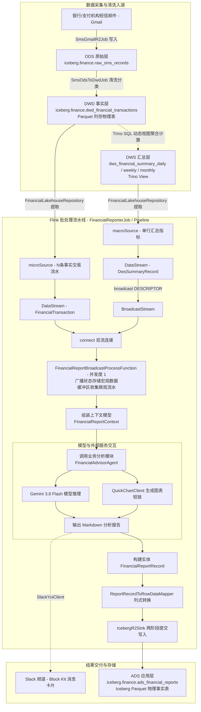

# Flink 批处理驱动的湖仓财务研报流水线：双流广播汇聚、LLM 结构化推理与原生 Iceberg 落盘架构实现

在数据湖仓（Lakehouse）架构中，将底层的交易明细与经过复式记账核算的宏观统计指标相结合，交由大语言模型（LLM）进行分析推理，并产出包含宏观指标、微观论据与图表链接的财务报告，同时完成“数据湖物理表持久化与即时通讯富文本推送”的双写操作，需要解决计算引擎调度、状态同步以及一致性写入等工程问题。

本方案基于 **Apache Flink 1.20**（运行于 `RuntimeExecutionMode.BATCH` 模式）、**Apache Iceberg 1.7** 列存湖仓、**Trino 471** 分布式 SQL 引擎、**LangChain4j 0.35** 接口体系、**QuickChart** 图表服务以及 **Slack Block Kit**，实现了批处理财务研报生成流水线。

本文整理该流水线的数据流转逻辑，涵盖双流广播、内存状态绑定、有界批处理触发机制、LLM 调用以及 Iceberg 写入的技术实现与关键决策。

---

## 1. 架构总览与数据流向

系统针对日（Daily）、周（Weekly）、月（Monthly）三个统计周期运行。数据由原始短信入湖开始，清洗提纯后形成事实层，汇总层通过 SQL 视图动态计算，应用层（ADS）由 Flink 批作业调度 LLM 完成研报生成与双写归档。

### 1.1 湖仓整体数据流向图



---

## 2. 为什么要做“宏观（Macro）与微观（Micro）”双流分离？

流水线设计采用双流输入模型，基于以下分析与架构考虑：

### 2.1 财务分析的数据结构要求
财务分析报告需要兼顾宏观与微观两个层次：
1. **宏观指标（Macro Summary）**：反映周期内的总收入、总支出、净支出、分类占比以及资金划转等宏观数据，作为全盘收支的核算依据。
2. **微观明细（Micro Transactions）**：包含具体的交易流水（交易对手、商户名称、时间与金额），为分析提供明细论据。

因此，报告生成需要将经过核算的宏观指标与明细交易记录相结合。

### 2.2 数据源的物理特征差异
两部分数据在数据湖中的存储与形态不同：
* **宏观数据源 (`macroSource`)**：
  读取 Trino 中的 DWS 视图。在一个统计周期内通常为单条汇总记录（包含净支出、毛支出、退款冲正、理赔收入、划转金额及各类目金额）。
* **微观数据源 (`microSource`)**：
  读取 DWD 事实物理表。包含当期时间窗口内的多笔交易记录流水。

这种不对称的输入规模，适合在流计算引擎中通过“广播单条汇总数据 + 消费明细交易流”的拓扑完成数据汇聚。

---

## 3. 核心类职责划分与设计模式

系统遵循分层架构设计，各模块职责如下：

| 模块分层 | 核心类全限定名 | 职责与角色定位 |
| :--- | :--- | :--- |
| **作业调度层 (Job)** | `com.finance.etl.jobs.FinancialReporterJob` | 批处理作业 Main 入口。解析命令行参数与环境变量，初始化 Flink 批处理环境，读取输入数据并提交执行拓扑。 |
| **拓扑编排层 (Pipeline)** | `com.finance.etl.pipeline.FinancialReporterPipeline` | Flink DAG 编排器。接收 Source 与 Sink 接口，定义流连接方式与处理流水线。 |
| **业务算子层 (Operator)** | `com.finance.etl.transform.report.FinancialReportBroadcastProcessFunction` | 双流汇聚算子。维护广播状态与微观明细缓冲，在输入消费结束时组装上下文并触发报告生成与双写。 |
| **湖仓数据访问层 (DAO)** | `com.finance.etl.repository.FinancialLakehouseRepository` | 封装 Trino JDBC 查询，负责检索 DWS 视图大盘与 DWD 事实流水。 |
| **业务处理层 (Agent)** | `com.finance.etl.agent.FinancialAdvisorAgent` | 分析处理模块。接收汇总上下文，调用 LLM 接口与图表工具生成 Markdown 格式报告。 |
| **声明式服务层 (Service)** | `com.finance.etl.service.FinancialAdvisorService` | 基于 LangChain4j 的声明式服务接口，定义 System Prompt 约束与格式规范。 |
| **图表与消息客户端层** | `com.finance.etl.client.QuickChartClient`<br>`com.finance.etl.client.SlackYuiClient` | 外部 HTTP 交互客户端（QuickChart 生成图表短链，Slack API 发送 Block Kit 消息）。 |
| **湖仓列式映射层 (Mapper)** | `com.finance.etl.sink.iceberg.ReportRecordToRowDataMapper` | 无状态映射函数。将研报业务实体映射为 Flink 列式内存行 `GenericRowData`。 |

---

## 4. 数据获取与输入源构建机制

流水线从 `FinancialReporterJob.main()` 启动，数据获取流程如下：

### 4.1 周期参数解析与自动探查
作业支持以下参数指定：
* `--period DAILY --date 2026-10-05`：指定日期，生成日度财务报告；
* `--period MONTHLY --month 2026-09`：指定月份，生成月度财务报告；
* **缺省自动探查**：未传入参数时，作业调用 `FinancialLakehouseRepository.queryLatestActiveDailySummary()`，通过 Trino SQL `ORDER BY stat_date DESC LIMIT 1` 自动锁定湖仓中最新包含有效支出的统计周期。

### 4.2 DWS 层采用 Trino View 的考量
在架构中，`dws_financial_summary_daily`、`dws_financial_summary_weekly`、`dws_financial_summary_monthly` 定义为 Trino 动态 SQL 视图（定义见 `scripts/schema-dws.sql`）：
* **一致性**：DWD 物理表 `dwd_financial_transactions` 为唯一事实存储。历史数据发生修正或重新清洗回流时，视图在被查询时实时计算，无需维护冗余物理表的同步作业。
* **查询性能**：基于 Iceberg 的 Parquet 列存结构与元数据过滤，单日或单月的聚合查询响应时间在毫秒至秒级范围内。

### 4.3 将数据封装为 Flink 有界批源
在 `FinancialReporterJob` 中，Trino 查询返回的宏观汇总记录 `DwsSummaryRecord` 与交易明细列表 `List<FinancialTransaction>` 分别封装为 Flink 有界数据源：
```java
DataGeneratorSource<DwsSummaryRecord> macroSource = new DataGeneratorSource<>(
        index -> finalMacro,
        1L,
        RateLimiterStrategy.noOp(),
        TypeInformation.of(DwsSummaryRecord.class)
);

DataGeneratorSource<FinancialTransaction> microSource = new DataGeneratorSource<>(
        index -> finalMicro.get(index.intValue()),
        (long) finalMicro.size(),
        RateLimiterStrategy.noOp(),
        TypeInformation.of(FinancialTransaction.class)
);
```

---

## 5. 拓扑编排与 Flink 广播机制深度解构

在 `FinancialReporterPipeline.build(env)` 中，核心拓扑通过标准的 DataStream API 组装完成。这段代码虽然只有短短十几行，但每一行都包含了 Flink 底层的核心技术约束。

### 5.1 为什么声明 `WatermarkStrategy.noWatermarks()`？
```java
DataStream<DwsSummaryRecord> macroStream = env
        .fromSource(macroSource, WatermarkStrategy.noWatermarks(), "Macro-DwsSummary-Source");
DataStream<FinancialTransaction> microStream = env
        .fromSource(microSource, WatermarkStrategy.noWatermarks(), "Micro-DwdTransaction-Source");
```
Flink 的新 Source API 要求必须传入水位线策略。在此处显式使用 `noWatermarks()` 的原因在于：
1. **有界批处理语义**：作业显式运行于 `RuntimeExecutionMode.BATCH` 模式，数据读完即终止，天然拥有明确的边界（End of Input），不需要依靠水位线去推算数据是否延迟到达；
2. **算子内部未定义事件时间窗口**：下游并没有调用任何 `.window(TumblingEventTimeWindows.of(...))`；
3. **消除无效开销与多流时钟锁死**：广播流只有 1 行数据，早早就会结束；如果开启水位线推进，可能导致下游由于等待该通道的时间戳推进而陷入非预期的阻塞。声明 `noWatermarks()` 可以消除后台无意义的水位线广播事件开销。

### 5.2 `MACRO_STATE_DESCRIPTOR` 到底是什么？
在算子中声明的：
```java
public static final MapStateDescriptor<String, DwsSummaryRecord> MACRO_STATE_DESCRIPTOR =
        new MapStateDescriptor<>(
                "macro-dws-summary-state",
                BasicTypeInfo.STRING_TYPE_INFO,
                TypeInformation.of(DwsSummaryRecord.class)
        );
```
它是一个**状态描述符（State Descriptor）**，包含了三项核心要素：
1. **状态唯一标识名（`"macro-dws-summary-state"`）**：作为 Checkpoint / Savepoint 备份到存储系统时的命名空间；
2. **Key 的类型元数据**（`String`，即统计周期标识 `periodValue`，如 `"2026-09"`）；
3. **Value 的类型元数据**（`DwsSummaryRecord` 实体类），Flink 会据此为其自动生成高效的二进制序列化器 `PojoSerializer`。

### 5.3 调用 `.broadcast(DESCRIPTOR)` 的作用与本质
在 Pipeline 中：
```java
BroadcastStream<DwsSummaryRecord> broadcastMacroStream = macroStream
        .broadcast(FinancialReportBroadcastProcessFunction.MACRO_STATE_DESCRIPTOR);
```
这句代码运行在作业提交阶段（编译期），**它并没有真正往内存里存入数据**。它的核心作用有两点：
1. **网络传输层的物理切换**：
   普通流采用 Hash 或 Rebalance 通道，一条数据只发给下游一个 TaskExecutor；调用 `.broadcast()` 后，网络底层切换为 **`BroadcastPartitioner`**，上游发射的那 1 行大盘数据会被 **100% 全量网络克隆，下发给下游的每一个并发子任务（Subtask）**。
2. **拓扑类型的契约演进**：
   将普通 `DataStream` 提升为强类型的 `BroadcastStream`，并在算子状态仓库中开辟以该 Descriptor 命名的受托管存储槽位。

### 5.4 为什么不直接在 stream 里拿数据，非要去状态库里取？
在 Flink 中，`.connect()` 并不是 SQL 意义上那个把左右两张表拼成宽表一行的“物理 Join”。
* 流是**事件驱动且时间错开的**：广播大盘数据先流经管道，如果不把它放进一个存储容器中，大盘数据流过方法体之后立刻会被 GC 垃圾回收！后续流过来的微观刷卡流水根本找不到大盘数据。
* 双输入算子拥有两个完全独立的方法入口：`processElement`（只喂给流水事实）与 `processBroadcastElement`（只喂给大盘记录）。在处理单笔流水时，参数列表里根本没有大盘字段，只能通过 Descriptor 钥匙去算子受托管的本地状态库中查取。

### 5.5 为什么必须在算子上显式锁定 `.setParallelism(1)`？
```java
SingleOutputStreamOperator<FinancialReportRecord> reportStream = microStream
        .connect(broadcastMacroStream)
        .process(reportProcessFunction)
        .setParallelism(1);
```
* 在通常的高吞吐流计算中，主流数据会被切片（Partition）分发给多个并发 Worker 并行处理；
* **但在财务报告生成场景中，分析任务需要依赖全局完整的交易明细**（例如跨全期挑选单笔最大支出、在各分类中识别重点商户）。
* 如果允许并发切片，每个 Worker 只获取到局部的交易数据，将导致报告上下文不完整并产生偏差。
* 因此，通过强制配置 **`Parallelism = 1`**，确保下游算子在集群中仅运行单实例，将当前统计周期的所有交易记录集中收集至该实例的内存缓冲区中。

---

## 6. 算子内部处理逻辑与业务触发机制

在核心算子 `FinancialReportBroadcastProcessFunction` 内部，数据处理流程分为三个阶段：

### 6.1 阶段一：广播宏观指标写入状态
在运行期，当 Trino DWS 视图的单条汇总记录到达时，Flink 触发回调：
```java
@Override
public void processBroadcastElement(DwsSummaryRecord macroRecord,
                                    Context ctx,
                                    Collector<FinancialReportRecord> out) throws Exception {
    if (macroRecord != null) {
        // 将 DWS 宏观汇总指标写入由 Flink 托管的状态中
        ctx.getBroadcastState(MACRO_STATE_DESCRIPTOR).put(periodValue, macroRecord);
    }
}
```
* 接收上游 `macroStream` 输出的 `macroRecord`。
* 算子利用具备写权限的 `Context`，以周期标识 `periodValue`（如 `"2026-10-05"`）为 Key，存入受托管的广播状态。

### 6.2 阶段二：微观交易流式缓冲
主流中的交易记录依次到达时，Flink 触发回调：
```java
@Override
public void processElement(FinancialTransaction transaction,
                           ReadOnlyContext ctx,
                           Collector<FinancialReportRecord> out) throws Exception {
    if (transaction != null) {
        microTransactionsBuffer.add(transaction);
        receivedMicroCount++;
    }

    // 当预期记录数达到最后一笔时，立即在持有 Collector 的方法内触发生成并发射
    if (expectedMicroRecordCount > 0 && receivedMicroCount >= expectedMicroRecordCount) {
        FinancialReportRecord record = triggerReportGeneration();
        if (record != null) {
            out.collect(record);
        }
    }
}
```
* 主流上下文为 `ReadOnlyContext`，只读广播状态，避免状态冲突。
* 将当前交易存入 `microTransactionsBuffer` 列表。
* **有界批处理完成判定**：
  Flink 算子的 `close()` 方法无法直接获取 `Collector<T>` 输出数据。因此算子在初始化时接收预期记录数 `expectedMicroRecordCount`，在接收到最后一笔交易时触发报告生成，并直接调用 `out.collect(record)` 将结果数据发射给下游 `IcebergR2Sink`。

### 6.3 阶段三：分析生成与图表服务调用
在 `triggerReportGeneration()` 内部：
1. **组装数据上下文**：将宏观指标与明细列表组装为 `FinancialReportContext`。
2. **构建 Prompt 文本**：`FinancialReportPromptBuilder` 将上下文序列化为包含收支指标、分类汇总与交易流水的格式化文本。
3. **调用分析模块**：`FinancialAdvisorAgent.generateReport(context)` 根据周期类型（Daily / Weekly / Monthly）调用对应逻辑，向 LiteLLM 网关发送请求。
4. **生成图表短链**：
   * 触发图表工具调用（Tool Calling）；
   * `FinancialChartTools` 调用 `QuickChartClient`，通过 `POST https://quickchart.io/chart/create` 获取图表短链；
   * 将图表 URL 插入 Markdown 正文中；
5. **Slack 消息推送**：
   * `SlackYuiClient.postReportWithBlocks(report)` 解析 Markdown 中的图片链接，生成 Slack Block Kit `image` 块；
   * 正文按字符限制切分为 `section` 块，推送到指定 Slack 频道。

---

## 7. 湖仓原生持久化写端设计：`ads_financial_reports`

将处理生成的分析数据以 Iceberg 表形式持久化存储在 Cloudflare R2：

### 7.1 DDL 表结构规格 (`scripts/schema-ads.sql`)
```sql
CREATE TABLE IF NOT EXISTS iceberg.finance.ads_financial_reports (
    report_id           VARCHAR,                             -- 主键 (如 'report_daily_2026-10-05')
    period_type         VARCHAR,                             -- 'DAILY', 'WEEKLY', 'MONTHLY'
    period_value        VARCHAR,                             -- '2026-10-05', '2026-W41'
    report_date         DATE,                                -- 归属日期 (隐藏分区字段)
    total_expense       DECIMAL(12, 2),                      -- 周期消费总额
    total_refund        DECIMAL(12, 2),                      -- 周期退款冲正
    net_expense         DECIMAL(12, 2),                      -- 周期净支出 (平账基准)
    total_income        DECIMAL(12, 2),                      -- 周期理赔回血
    total_transfer      DECIMAL(12, 2),                      -- 周期信用卡还款流水
    tx_count            BIGINT,                              -- 有效交易笔数
    metrics_json        VARCHAR,                             -- 结构化切片 JSON 快照
    summary_text        VARCHAR,                             -- 完整 Markdown 研报正文
    chart_url           VARCHAR,                             -- QuickChart 短链 URL (JSON 数组)
    slack_status        VARCHAR,                             -- 'SENT', 'FAILED', 'SKIPPED'
    created_at          TIMESTAMP(6) WITH TIME ZONE          -- 入湖时间戳
)
WITH (
    format = 'PARQUET',
    partitioning = ARRAY['month(report_date)'],              -- Iceberg 隐藏分区
    sorted_by = ARRAY['report_date DESC']
);
```

### 7.2 实体映射：`ReportRecordToRowDataMapper`
将领域对象 `FinancialReportRecord` 映射为 Flink 列式内存行 `GenericRowData(15)`。
* 关键点：`report_date` 映射为以 epoch day（自 1970-01-01 以来的整型天数），以便底层触发 Iceberg 的 `month(report_date)` 隐藏分区路由。

### 7.3 流水线挂载写端与 Equality Delete 规则
在 `FinancialReporterPipeline.java` 中：
```java
IcebergR2Sink adsSink = IcebergR2Sink.fromConfig("ads_financial_reports", "report_id,report_date");
DataStream<RowData> rowStream = reportStream
        .map(new ReportRecordToRowDataMapper())
        .name("ReportRecord-To-RowData")
        .uid("report-to-rowdata");
adsSink.append(rowStream);
```
* **技术约束点**：在 Iceberg 分区表上开启 Upsert 模式时，Equality 字段**必须包含分区键对应的源字段**。此处显式声明 Equality 列为 `report_id,report_date`，使得重新运行同一天或同一周/月的报表任务时，底层自动生成 Equality Delete 文件完成覆盖，保持幂等性。
* **单并发约束**：`IcebergR2Sink` 内部配置 `writeParallelism = 1`，将单条研报记录合并写入 Parquet 数据文件，避免小文件产生，并在批处理结束时由 `IcebergFilesCommitter` 完成 Snapshot 提交。

### 7.4 零 Schema 改造的多图存储与起止日期拓展
在不变更既有 Iceberg 表结构的约束下，利用字段做格式扩展：
1. **多图链接存储 (`chart_url` 列)**：
   * 自动提取 Markdown 中出现的全部 QuickChart 短链（去重处理）；
   * 将多张图表序列化为标准的 JSON 数组字符串（如 `["https://quickchart.io/...1", "https://quickchart.io/...2"]`）直接写入 `chart_url` 字段；
   * 在 Trino / DBeaver 中，可通过 `json_extract_scalar(chart_url, '$[0]')` 提取首图，或通过 `json_array_length(chart_url)` 统计图表总数；
   * 在 Java 领域模型 `FinancialReportRecord` 中，提供 `getChartUrlList()` 与 `getPrimaryChartUrl()` 保持代码调用兼容。
2. **周期时间边界记录 (`metrics_json` 列)**：
   * 针对周度和月度报表，将 `startDate` 与 `endDate` 直接内嵌在 `metrics_json` 中（如 `"startDate":"2026-10-05","endDate":"2026-10-11"`）；
   * 业务方可通过 JSON 字段读取起止日期，也可以通过基准锚定日 `report_date`（周一）在 SQL 中使用日期函数衍生出自然周区间。

### 7.5 调度决策、动态周感知与时间窗口重算机制
针对周度报表（Weekly Report）的触发逻辑：
1. **调度模式策略**：
   * **显式指定模式 (`--week 2026-W40`)**：作业直接处理指定周，用于历史周度研报的数据重算与回补；
   * **自动感知模式 (缺省未传参)**：作业向 Trino DWS 视图发起探测查询：
     ```sql
     SELECT week_period FROM iceberg.finance.dws_financial_summary_weekly
     WHERE tx_count > 0 ORDER BY week_period DESC LIMIT 1;
     ```
     以湖仓中实际存在动账流水的最高周作为目标周期（如当前探查到 `2026-W41`）。
2. **报表层全量核算特征**：
   * 流式增量水位（`etl_sync_offsets`）服务于 ODS/DWD 层的数据去重与断点续传；
   * 报表层（ADS）面向的是整个自然时间窗口的收支核算，属于时间窗口级全量聚合，不依赖单调递增的流位点。
3. **同周内多次触发的覆盖更新机制**：
   * 若同一周内产生新流水并再次运行作业，系统重新聚合截至当前时刻的最新交易；
   * Flink 通过 Iceberg Equality Delete（`report_id, report_date`）在写入时覆盖旧记录，保证湖仓中保留当前周最新的报告；
   * 当进入下周且产生新流水后，最新周探测自然切换为新周次。

---

## 8. 端到端测试与真实落盘验证

为了确保整套复杂拓扑的严密性，测试套件分层覆盖：
1. **`FinancialReportBroadcastProcessFunctionTest`**：使用 Mock 依赖，在毫秒级内验证算子的缓冲、上下文组装与研报触发逻辑；
2. **`FinancialReporterPipelineTest`**：驱动本地 MiniCluster，验证双流连接拓扑能够正确生成 Flink 执行图（Execution Plan），证明通道连接无死锁；
3. **`FinancialReporterJobIntegrationTest`**：真实的端到端湖仓落盘集成测试。
   * 提交批作业并等待执行结束；
   * 通过官方 `IcebergGenerics.read(table)` 直接物理扫描 Cloudflare R2 上的表文件；
   * **扫描实测输出**：
     ```text
     2026-10-09 02:07:12.836 INFO  SnapshotScan - Scanning table finance.ads_financial_reports snapshot 5746070051761336574
     [Row 1] report_id=report_daily_2026-10-05, period=2026-10-05, date=2026-10-05, slack=SKIPPED
     ================================================================================
     Table finance.ads_financial_reports row count: 1
     ================================================================================
     ```
   * 证明整套从 Flink 双流广播 $\to$ 状态缓冲 $\to$ 报告生成 $\to$ 列式转换 $\to$ Iceberg 两阶段提交的完整链路实现端到端闭环。

---

## 9. 总结

本套架构的核心设计点包括：
1. **拓扑解耦**：避免在数据处理算子内部直接执行跨网络数据库查询，通过 Flink 广播流与状态后端机制处理汇总数据与交易流水的数据同步。
2. **输入约束**：报表分析基于数据湖中完成汇总核算的结构化指标与真实交易明细，保证分析结果与底层数据一致。
3. **闭环链路**：通过单次批处理作业串联报表分析、消息通知与 Iceberg ADS 事实表持久化写入。
